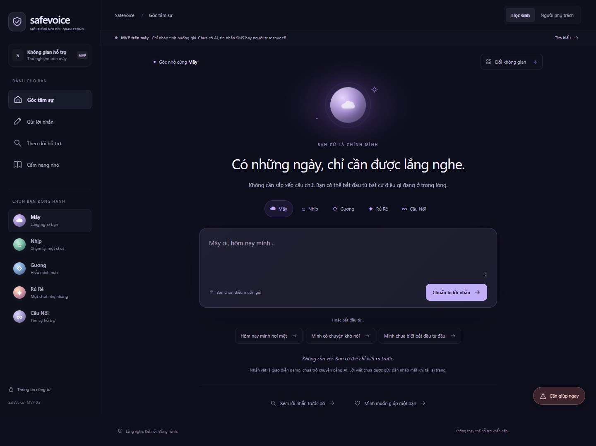
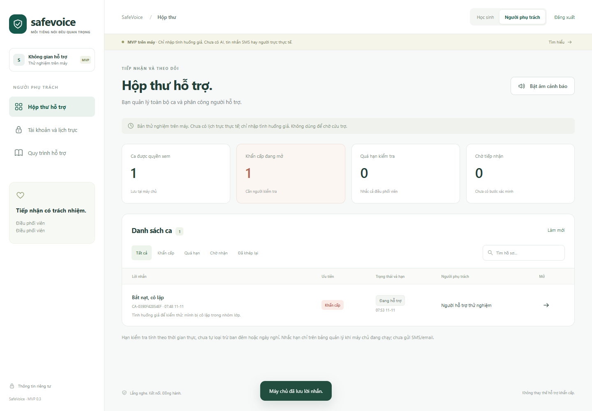
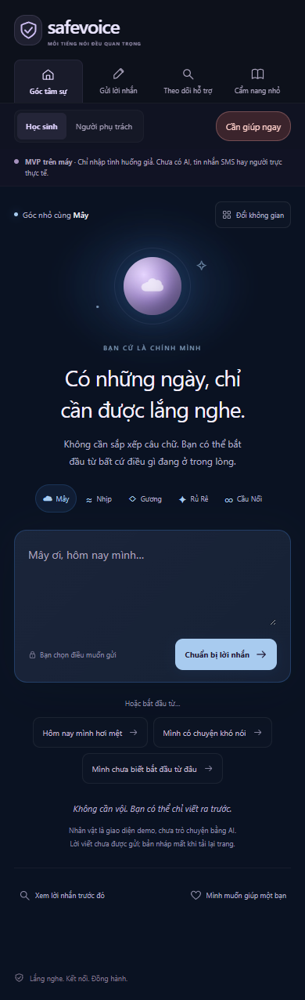

# Bàn giao SafeVoice MVP 0.3

Ngày 11/11/2026. Đây là bản chạy trên máy, chỉ dùng dữ liệu giả.

## Đã hoàn thành

- Máy chủ Node.js và cơ sở dữ liệu SQLite; dữ liệu tồn tại sau khi đóng trình duyệt.
- Đăng nhập điều phối viên/người hỗ trợ, phân quyền theo ca, tạo tài khoản và đổi mật khẩu.
- Gửi không ghi tên hoặc có cách liên hệ an toàn; mã bí mật riêng cho người báo.
- Nhắn tin hai chiều, xác nhận tiếp nhận, phân công và cập nhật trạng thái.
- Hẹn kiểm tra lại, nhắc quá hạn cho người được phân công và điều phối viên trên bảng quản lý.
- Lịch sử thao tác nội bộ, yêu cầu lý do khi đổi ưu tiên hoặc đóng ca, tránh ghi đè cập nhật đồng thời.
- Nút yêu cầu khẩn cấp chủ động, giữ nguyên giới hạn của bản thử nghiệm.
- Giữ nền và nhân vật; sửa điều hướng điện thoại.
- Sao lưu SQLite có kiểm tra tính toàn vẹn, tài liệu khôi phục và lộ trình tiếp theo.

## Đã kiểm chứng

26 kiểm thử lõi/API đã qua. Hành trình trình duyệt tự động đã qua: đổi nền và nhớ lựa chọn, gửi tin có liên hệ, đăng nhập, tạo người hỗ trợ, phân công, xác nhận, phản hồi, xem nhật ký, học sinh nhắn lại, tra cứu sau tải lại, yêu cầu khẩn cấp, giới hạn ca của người hỗ trợ, đổi mật khẩu và giao diện 390 px.

Tài khoản, mật khẩu, cơ sở dữ liệu và bản sao lưu không thuộc mã nguồn Git. Các ảnh giao diện trong `docs/images/` chỉ chứa tình huống giả.

## Mở lại khi cần

Mở `Mo-SafeVoice.cmd`, truy cập http://127.0.0.1:4178. Mở `Mo-Tai-Khoan.cmd` để xem mật khẩu ban đầu được tạo riêng trên máy. Xem README để đổi mật khẩu, thử hai cửa sổ và sao lưu.

## Những gì chưa triển khai

Chưa có AI thật, thông báo ngoài ứng dụng, trực 24/7, HTTPS phục vụ qua Internet, MFA, cơ sở dữ liệu mã hóa, nhiều trường, chính sách dữ liệu hoàn chỉnh hoặc phê duyệt chuyên môn/pháp lý. Không dùng với học sinh thật ở trạng thái hiện tại. Nhắc hạn là mốc diễn tập theo thời gian liên tục, chưa xử lý lịch nghỉ.

## Danh sách cần chủ dự án duyệt cho giai đoạn sau

Xem [kế hoạch và phê duyệt](KE-HOACH-VA-PHE-DUYET.md): trường thử nghiệm và người trực; phạm vi học sinh; pháp lý và quyền riêng tư; nơi chạy và ngân sách; kênh cảnh báo và người nhận; nhà cung cấp AI và dữ liệu được gửi; tên thương hiệu; điều kiện công bố ứng dụng.

## Ảnh giao diện

